# AltWiki

A self-hosted team wiki built on [Docmost](https://github.com/docmost/docmost) v0.97.

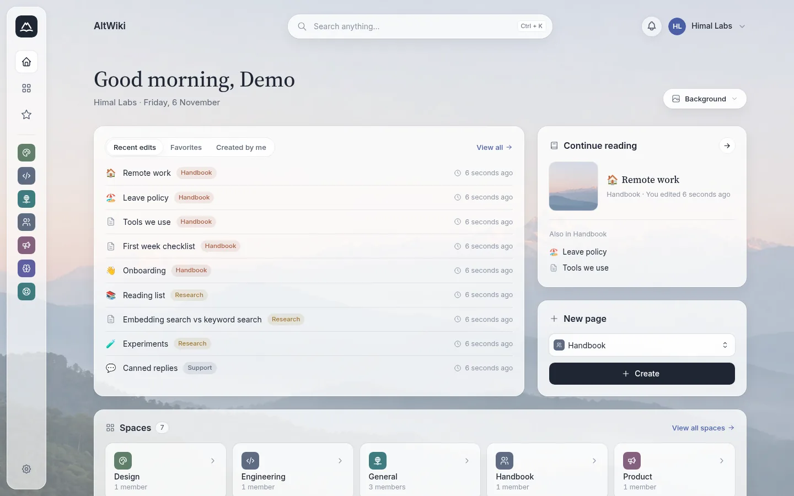

AltWiki keeps everything Docmost does (real-time collaborative editing, spaces, permissions, search) and adds a calmer interface plus tools our teams needed day to day: Confluence migration, a GitHub docs generator, and finer control over the page tree.

## Contents

- [Features](#features)
- [Screenshots](#screenshots)
- [Getting started](#getting-started)
- [Configuration](#configuration)
- [Development](#development)
- [Upgrading from upstream](#upgrading-from-upstream)
- [Credits and license](#credits-and-license)

## Features

### Added in AltWiki

- **Alpine-glass UI.** Frosted panels over a landscape photo. Each user picks their own background (four presets, plain, or an uploaded image, with a dim slider). Only that user sees it.
- **Space rail and bento home.** A slim rail with every space, and a home page with recent edits, favourites, "continue reading", quick page creation and a space grid.
- **Space icons.** Pick an icon and colour from a built-in set, shuffle, or upload an image.
- **Confluence import.** Import a Confluence XML space export, including attachments, images and video.
- **GitHub docs generator.** Generate documentation pages from a GitHub repository, written by Gemini (`GEMINI_API_KEY`).
- **Page tree control.** Rename pages inline in the sidebar, and keep a manual drag-and-drop order (the default) or sort.
- **Change page owner.** Workspace admins can hand a page to another member.
- **Automatic subpage sections.** Parent pages list their child pages.
- **Bulk page actions.** Select several pages in the sidebar to move or delete them together.
- **Open spaces.** Spaces marked open are visible to the whole workspace.
- **Glass search.** Ctrl+K / Cmd+K search popup with space, type and title filters.

### From Docmost

- Real-time collaboration
- Rich editor: tables, callouts, code blocks, task lists, embeds, math (KaTeX), footnotes, RTL text
- Diagrams: Draw.io, Excalidraw and Mermaid
- Comments
- Page history and version compare
- Presentation mode
- Spaces, groups and permissions
- Public sharing of pages and spaces
- Full-text search
- Import and export (Markdown, HTML, DOCX and more)
- Notifications and page / space watching
- Favourites
- Templates
- Integrations: GitHub, Figma and Linear (OAuth, see [Configuration](#configuration))
- REST API
- Translations into many languages

## Screenshots

| | |
|---|---|
| 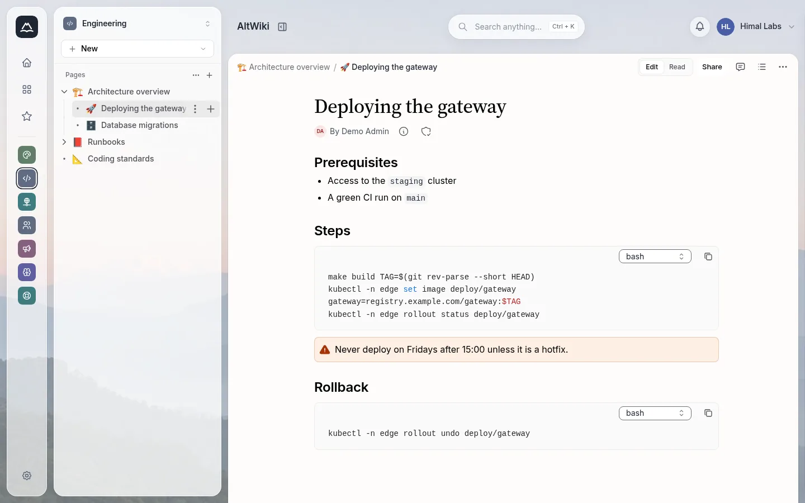 Page view with sidebar tree | 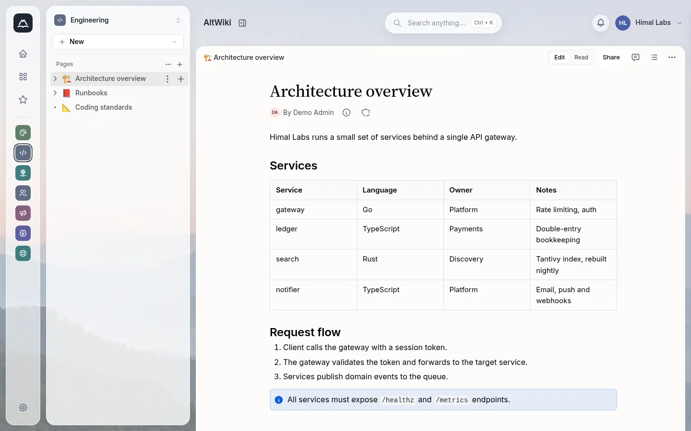 Tables and callouts |
| 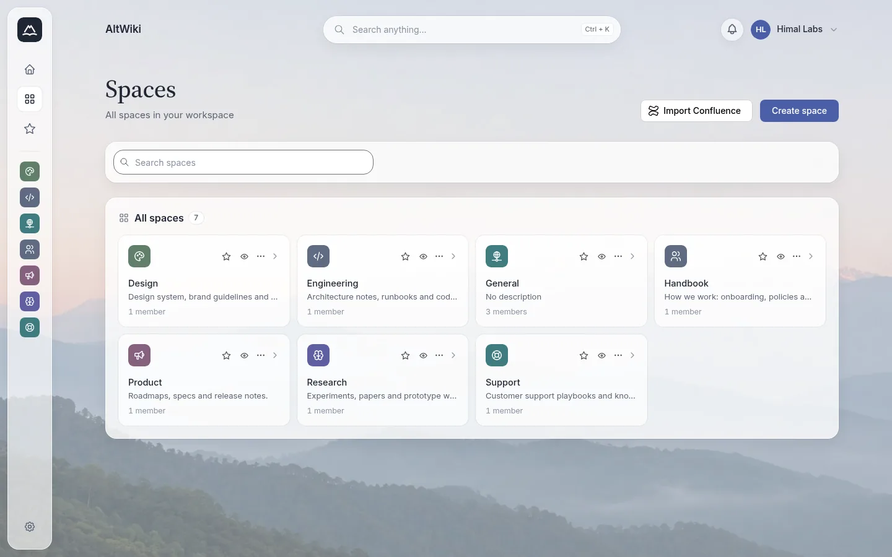 Spaces | 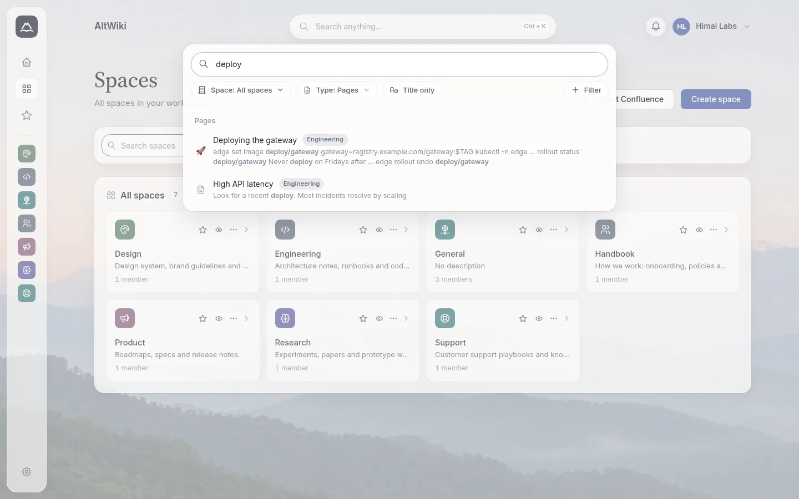 Search (Ctrl+K) |
| 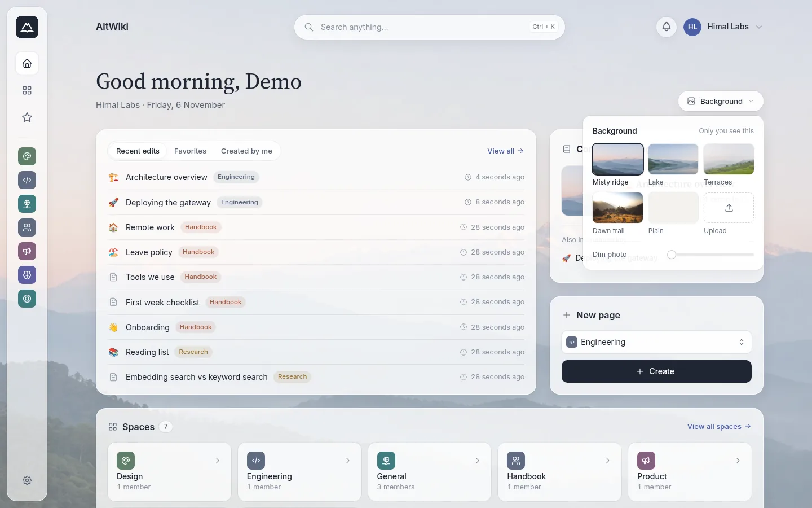 Per-user background | 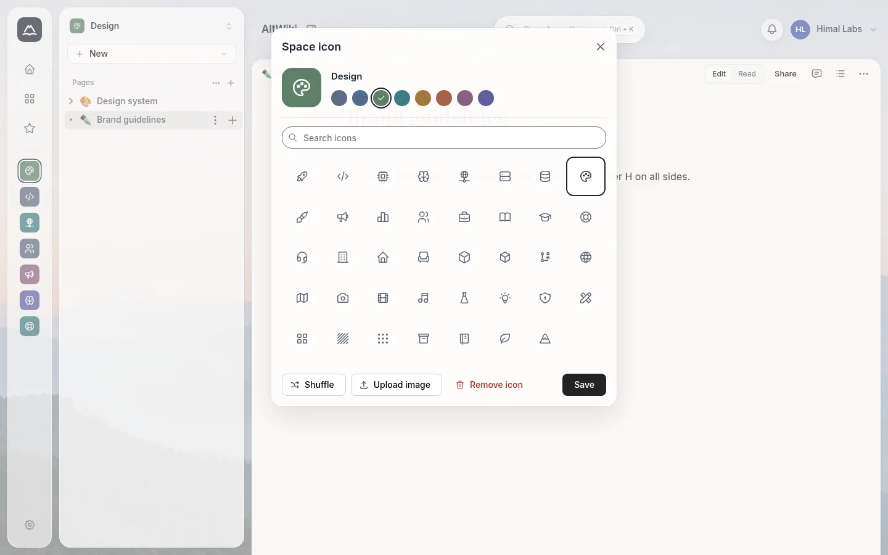 Space icon picker |
| 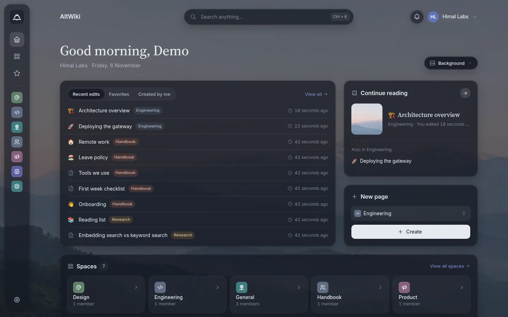 Dark mode | 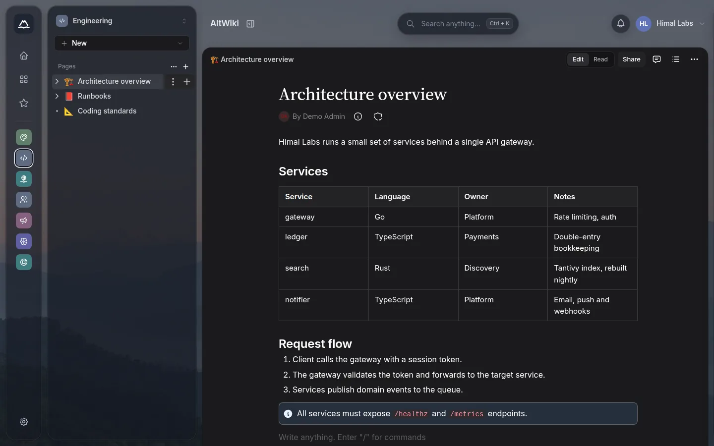 Dark mode page |
| 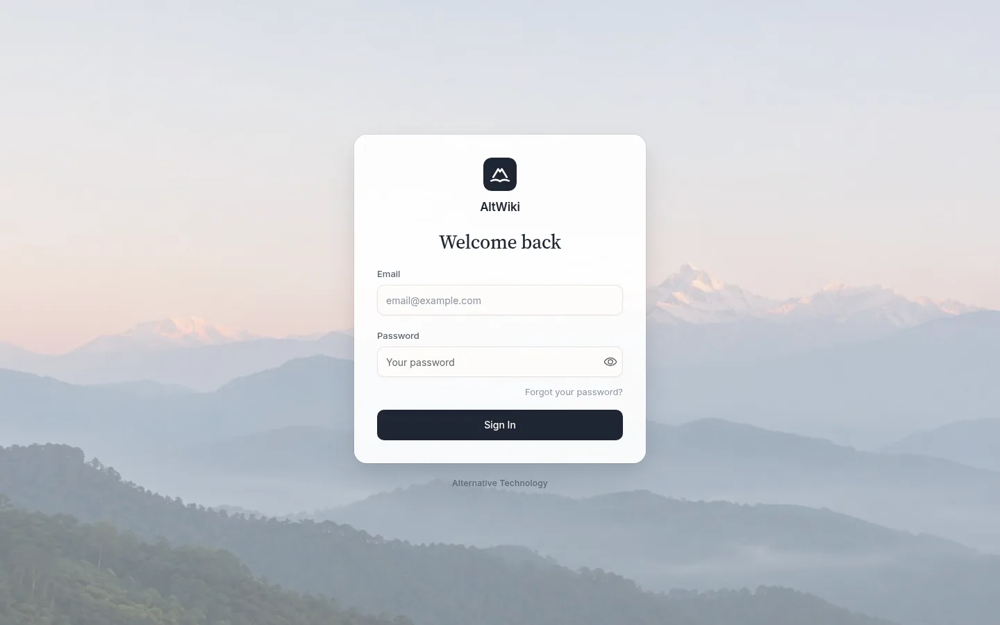 Login | 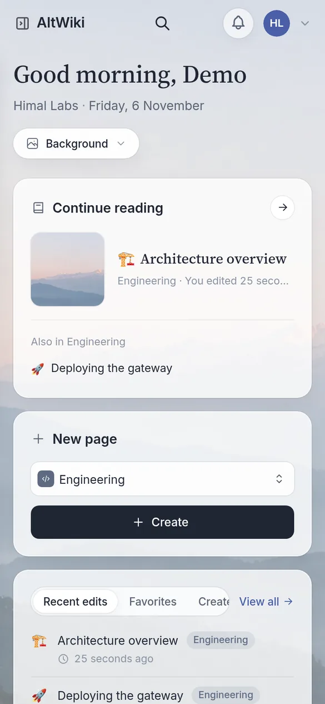 Mobile |

Screenshots use a demo workspace with fictional content.

## Getting started

AltWiki runs as one app container plus PostgreSQL and Redis. There is no published image; build it from this repository.

1. Clone the repository.

   ```bash
   git clone https://github.com/StarAtNyte/AltWiki.git altwiki
   cd altwiki
   ```

2. Create the secrets file from the template and fill it in.

   ```bash
   cp .env.prod.example .env.prod
   ```

   Set at least `APP_SECRET` (generate with `openssl rand -hex 32`), `POSTGRES_PASSWORD`, and a matching `DATABASE_URL`, for example `postgresql://docmost:<POSTGRES_PASSWORD>@db:5432/docmost?schema=public`. Never commit `.env.prod`.

3. Edit `docker-compose.yml`: set `APP_URL` to your public URL and adjust the SMTP settings and port mapping.

4. Build the image and start the stack.

   ```bash
   docker compose build
   docker compose up -d
   ```

5. Open `APP_URL` and create the first workspace and admin account. Database migrations run automatically on start.

Put a reverse proxy with TLS in front of the app for production use. Back up the `db_data` and `altwiki` (file storage) volumes.

## Configuration

AltWiki reads the same environment variables as Docmost. See `.env.example` for the full list. The most used ones:

| Variable | Required | Description |
|---|---|---|
| `APP_URL` | yes | Public base URL, for example `https://wiki.example.com` |
| `APP_SECRET` | yes | Long random string used to sign sessions |
| `DATABASE_URL` | yes | PostgreSQL connection string |
| `REDIS_URL` | yes | Redis connection string |
| `MAIL_DRIVER` | no | `smtp` or `postmark` |
| `SMTP_HOST`, `SMTP_PORT`, `SMTP_USERNAME`, `SMTP_PASSWORD`, `SMTP_SECURE` | for email | SMTP settings for invitations and notifications |
| `MAIL_FROM_ADDRESS`, `MAIL_FROM_NAME` | for email | Sender of outgoing email |
| `STORAGE_DRIVER` | no | `local` (default), `s3` or `azure`, with the matching `AWS_S3_*` / `AZURE_STORAGE_*` variables |
| `FILE_UPLOAD_SIZE_LIMIT` | no | Maximum upload size, for example `50mb` |
| `DRAWIO_URL` | no | Self-hosted Draw.io URL |
| `GEMINI_API_KEY` | for GitHub docs | Google Gemini API key for the GitHub docs generator |
| `INTEGRATION_GITHUB_CLIENT_ID`, `INTEGRATION_GITHUB_CLIENT_SECRET` | for GitHub | OAuth app for the GitHub integration |
| `INTEGRATION_FIGMA_CLIENT_ID`, `INTEGRATION_FIGMA_CLIENT_SECRET` | for Figma | OAuth app for the Figma integration |
| `INTEGRATION_LINEAR_CLIENT_ID`, `INTEGRATION_LINEAR_CLIENT_SECRET` | for Linear | OAuth app for the Linear integration |
| `DISABLE_TELEMETRY` | no | Set `true` to turn off upstream telemetry |

### Integrations

Create one OAuth app per provider and set its callback URL to:

```
https://<your-domain>/api/integrations/oauth/<provider>/callback
```

where `<provider>` is `github`, `figma` or `linear`. Providers without client ID and secret show as "not configured" in the integrations settings.

## Development

Requirements: Node.js (see `Dockerfile` for the version in use), pnpm 11 (`packageManager` in `package.json`), PostgreSQL and Redis.

```bash
pnpm install
cp .env.example .env        # point DATABASE_URL and REDIS_URL at local services
pnpm editor-ext:build       # shared editor package, needed once before dev
pnpm dev                    # client (Vite) and server (NestJS) together
```

Other scripts:

| Command | Description |
|---|---|
| `pnpm client:dev` | Client only |
| `pnpm server:dev` | Server only, with watch |
| `pnpm collab:dev` | Collaboration server only |
| `pnpm build` | Build all packages with Nx |
| `pnpm start` | Run the built server |
| `pnpm --filter ./apps/server migration:latest` | Run database migrations |
| `pnpm --filter ./apps/server migration:create <name>` | Create a migration |

The repository is an Nx and pnpm monorepo:

- `apps/client`: React + Mantine frontend
- `apps/server`: NestJS backend and collaboration server
- `packages/editor-ext`: Tiptap editor extensions shared by both

## Upgrading from upstream

AltWiki follows Docmost releases. For v0.97 the fork was rebased by porting rather than merging:

1. Start a branch from the upstream release tag (`v0.97.0`).
2. Re-apply the AltWiki server changes as one commit, then the client redesign as another.
3. Resolve conflicts against the new upstream code, run the migrations on a copy of production data, and test on a staging stack before deploying.

Keep AltWiki changes in self-contained files where possible (`apps/client/src/features/background`, `features/space/icons`, `features/github-docs`, `styles/glass.css` and so on) so the next port stays small.

## Credits and license

AltWiki is built on [Docmost](https://github.com/docmost/docmost) by the Docmost team. Huge thanks to them for an excellent open-source wiki.

AltWiki is licensed under the [GNU Affero General Public License v3.0](LICENSE), like upstream Docmost. If you run a modified version for others over a network, you must offer them its source code.

Docmost Enterprise Edition code is not part of AltWiki's feature set:

- The `apps/server/src/ee` submodule is not included in AltWiki builds.
- `apps/client/src/ee` is upstream code under the Docmost Enterprise License (see `apps/client/src/ee/LICENSE`). Its features are not enabled in AltWiki.

Third-party assets:

- Background photos: `ridge.jpg`, `lake.jpg` and `terraces.jpg` were generated for AltWiki. `trail.jpg` is "Himalaya sunrise" from Wikimedia Commons, CC0 1.0. See `apps/client/public/backgrounds/CREDITS.md`.
- Fonts: Inter and Source Serif 4, under the SIL Open Font License 1.1 (`apps/client/public/fonts/OFL.txt`).
